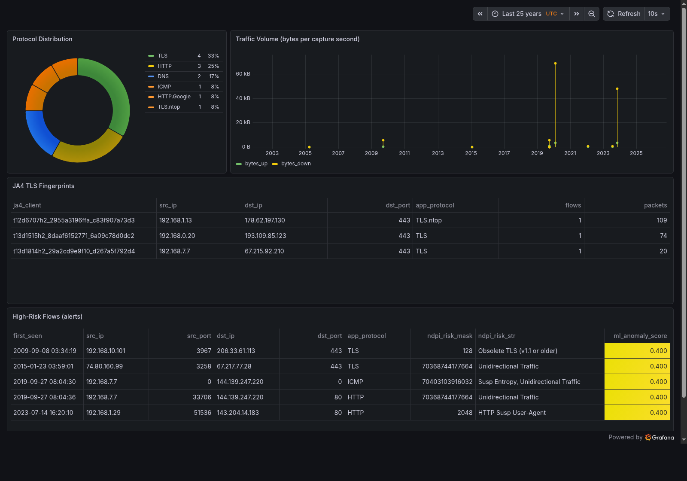
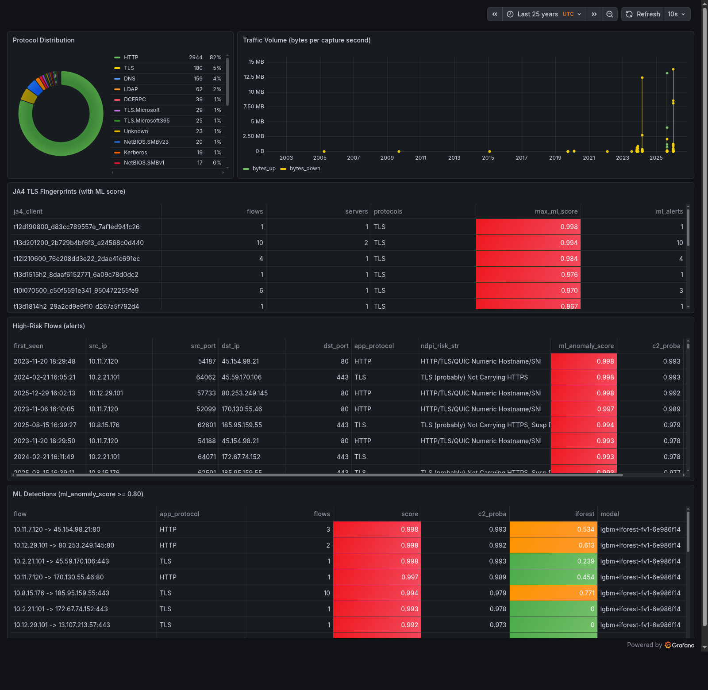

# SentinelFlow — Encrypted-Traffic C2 Detection and Kernel Blocking, Without Decryption

SentinelFlow watches network flows, recognises command-and-control (C2) traffic **without decrypting TLS**, and blocks the C2 server in the Linux kernel. It uses flow metadata only: nDPI protocol classification, JA4 TLS fingerprints, nDPI risk flags, packet-size and inter-arrival-time statistics.

- **Plane 1:** a C sensor (libpcap + nDPI 6.1) turns packets into 23-field flow records and pushes them over ZeroMQ.
- **Plane 2:** a Python daemon validates and stores them (SQLite / ClickHouse) and scores them with a LightGBM model exported to ONNX.
- **Plane 3:** blocks the remote C2 address through an nftables set with per-address drop counters.

> **How to read this README.** Every number below was measured on the reference host and is quoted from a report in `sentinel-flow/`: [`part1.md`](sentinel-flow/part1.md), [`part1_2.md`](sentinel-flow/part1_2.md), [`part2.md`](sentinel-flow/part2.md), [`Part3.md`](sentinel-flow/Part3.md), [`Part4.md`](sentinel-flow/Part4.md). Each report ends with a "may / must not be said" section, and this README follows it. Limits are listed in [What is not shown](#what-is-not-shown).

**Status (2026-10-24):**

| Phase | Status |
|---|---|
| 1. C sensor | done |
| 2. Ingestion & analytics | done |
| 3. ML pipeline | done |
| 4. Kernel mitigation | done with nftables; XDP experimental, not attached |
| 5. Demo | not started |

The original blueprint and roadmap are kept in [`sentinel-flow/docs/BLUEPRINT.md`](sentinel-flow/docs/BLUEPRINT.md).

---

## Architecture

```
 NIC / veth / PCAP file
        │
        ▼
┌───────────────────────────────────────────────────────────────────────────┐
│ PLANE 1 — C sensor  (sensor-c/, libpcap + nDPI 6.1, single thread)        │
│  • link types: Ethernet (+802.1Q), Linux cooked v1/v2, BSD loopback, raw IP│
│  • 5-tuple flow table (uthash), 30 s idle timeout, -A active timeout       │
│  • nDPI app protocol, JA4 client fingerprint (TLS-family flows only),      │
│    64-bit nDPI risk mask, Welford IAT / packet-length statistics           │
│  • 23-field JSON per flow ──► ZeroMQ PUSH                                  │
└───────────────────────────────┬───────────────────────────────────────────┘
                                │  ipc:///tmp/ndpi_flows.sock
                                ▼
┌───────────────────────────────────────────────────────────────────────────┐
│ PLANE 2 — engine-ml/daemon.py (Python standard library + optional ONNX)   │
│  • ZMQ PULL (pyzmq if present, else the C zmq_sink helper)                 │
│  • validates the 23 fields, batches 1,000 rows or 1 s                      │
│  • features.py (61 features) ─► ONNX LightGBM  ─► ml_anomaly_score         │
│                                 ONNX IsolationForest ─► ml_iforest_score   │
│    (falls back to a stdlib heuristic when onnxruntime is unavailable)      │
│  • + 6 enrichment columns = 29 columns per flow                            │
│  • SQLite (WAL) + JSONL always; ClickHouse when reachable ─► Grafana       │
└───────────────────────────────┬───────────────────────────────────────────┘
                                │  scored batch
                                ▼
┌───────────────────────────────────────────────────────────────────────────┐
│ PLANE 3 — engine-ml/mitigator.py                                          │
│  • BlockPolicy: score ≥ 0.80 (trained model) OR severe nDPI risk;          │
│    targets the remote peer; never RFC 1918 / loopback / link-local /       │
│    multicast / allowlisted addresses                                       │
│  • nftables: table inet sentinel, set blocked_ipv4 { flags timeout;        │
│    timeout 15m; counter; }, drop in prerouting (saddr), output/forward     │
│    (daddr); per-address packet/byte counters read back every 10 s          │
│  • audit: mitigations.jsonl, SQLite blocked_ips, ClickHouse mitigations    │
│  • XDP (mitigation-ebpf/): sources compile, NOT attached (experimental)     │
└───────────────────────────────────────────────────────────────────────────┘
```

**Stored schema:** 23 sensor fields (5-tuple, `app_protocol`, `ja4_client`, `ndpi_risk_mask`, `ndpi_risk_str`, packet/byte counts, duration, 4 IAT stats, 2 packet-length stats, 2 ratios, `first_seen_us`, `last_seen_us`), plus 6 daemon columns (`ingested_at_us`, `ml_anomaly_score`, `is_alert`, `ml_c2_proba`, `ml_iforest_score`, `ml_model`) = **29 columns**. Both SQLite and ClickHouse report 29 columns for `network_flows`. Earlier documents said "24-field schema"; the sensor emits 23.

---

## Key verified metrics

| Area | Result | Conditions | Source |
|---|---|---|---|
| Sensor throughput | **~0.40 Mpps median**, 25.8 MB peak RSS, 0 flows dropped | Offline, single thread, i7-1165G7. 124,070 packets merged from 576 nDPI test captures. Current binary: medians 407 k pps (`-A 60`) and 400 k pps (`-A 0`), range 0.36–0.42 Mpps over 10 runs. Before the Phase 4 changes: 0.40–0.44 Mpps. Live-capture throughput not measured. | [Part3 §3.2](sentinel-flow/Part3.md) |
| Memory safety | **0** AddressSanitizer / LeakSanitizer / UBSan errors | 16 PCAPs (1,890 flows) in Part 3; 10 PCAPs with `-A 30` in Part 4. LeakSanitizer shown active on a deliberate 4,242-byte leak. | [Part3 §3.1](sentinel-flow/Part3.md), [Part4 §1.2](sentinel-flow/Part4.md) |
| Delivery sensor → consumer | 9,694 / 9,694 flows, 0 dropped | Same merged capture, consumer attached. Earlier silent loss fixed (receive high-water mark). | [Part3 §3.6](sentinel-flow/Part3.md) |
| Labeled dataset | **9,659 flows from 601 PCAPs** | 1,825 malicious flows from 28 captures / 25 families (malware-traffic-analysis.net with hand-curated IOC labels, plus nDPI samples). 0 dropped, 0 rejected. Built through the production sensor → ZMQ path. | [Part3 §4–5](sentinel-flow/Part3.md) |
| Model quality (grouped CV) | **ROC-AUC 0.980 ± 0.001, PR-AUC 0.905 ± 0.007** | 5-fold grouped by capture, 5 seeds. At the 0.80 alert threshold: recall 0.45 ± 0.04, precision 0.91 ± 0.03, FPR 1.1 % ± 0.4 %. | [Part3 §7.1](sentinel-flow/Part3.md) |
| Unseen infections (holdout) | **5 / 5 infections detected**; precision 99.6 %, FPR 0.6 % | 5 captures never used in training, replayed through the live daemon. 15 / 23 malicious endpoints alerted by ML (16 / 23 with severe-risk blocking). 3 false alerts out of 498 benign flows. Flow-level recall 23 %. | [Part3 §9.1](sentinel-flow/Part3.md), [Part4 §5](sentinel-flow/Part4.md) |
| ONNX export | 0 / 9,597 alert decisions differ from the native models | max \|Δp\| 3.7e-4 (LightGBM) | [Part3 §8.1](sentinel-flow/Part3.md) |
| Batch scoring in the daemon | **740 flows in 40.3 ms**; 1,000-flow batches in 36–47 ms | Feature extraction + both ONNX models, 1 onnxruntime thread | [Part4 §7.2](sentinel-flow/Part4.md), [Part3 §9.2](sentinel-flow/Part3.md) |
| Closed loop (capture → score → block → drop) | **0 / 50 packets delivered from the blocked C2 address; nft counter exactly 50 packets / 6,400 bytes; 50 / 50 delivered from a normal peer** | Holdout DarkGate capture replayed with `sensor -r`. Daemon scored it (0.991) and blocked both C2 endpoints in nftables automatically. Throwaway network namespaces. | [Part4 §7.2](sentinel-flow/Part4.md) |
| Tests | 13 + 24 + 10 sensor tests, 15 + 18 engine tests, all passing | `make test-sensor`, `make test-engine` | [Part4 §1.2, §2.2](sentinel-flow/Part4.md) |

---

## Quick start

### One-command setup (Ubuntu / Debian / Kali)

```bash
git clone https://github.com/AbdeldjallilZennir/sentinel-flow && cd <repository>
bash sentinel-flow/scripts/install_deps.sh            # core: packages, nDPI (pinned commit), sensor, ONNX runtime, tests
bash sentinel-flow/scripts/install_deps.sh --all      # + training venv, tshark/7z, Docker, clang (see --help)
```

Run it as your normal user; it uses `sudo` only for `apt`. It clones nDPI to `~/nDPI` at the commit this project was verified with (`90eb617a4`), builds it and the sensor, creates `engine-ml/.venv-runtime`, and runs both test suites.

Then capture live on one interface (dry-run by default; Ctrl+C stops everything cleanly):

```bash
cd sentinel-flow
bash scripts/run_live.sh -i <interface> -a <your admin IP> --serve
```

For a two-machine VM lab (host-only network, dashboard over an SSH tunnel, optional Grafana), see [`sentinel-flow/docs/LAB_SETUP.md`](sentinel-flow/docs/LAB_SETUP.md).

### Prerequisites (manual setup)

| Requirement | Notes |
|---|---|
| Linux, gcc, cmake, libpcap, libzmq | build the sensor |
| nDPI 6.x built from source at `~/nDPI` | set `-DNDPI_ROOT=…` for another path. At runtime: `export LD_LIBRARY_PATH=~/nDPI/src/lib` |
| Python 3 | the daemon and dashboard need only the standard library |
| ONNX scoring | numpy + onnxruntime, provided by `make runtime-venv` |
| Training only | `engine-ml/requirements-train.txt` |
| `sudo` | only for the closed-loop test (network namespaces + nftables) |
| Docker | only for ClickHouse + Grafana |

### Build and test

```bash
cd sentinel-flow
make sensor            # C sensor, zmq_sink, unit-test binaries
make test-sensor       # test_flow 13/13, test_stats 24/24, PCAP regression tests 10/10
make test-engine       # daemon 15/15, mitigator 18/18
make runtime-venv      # self-contained numpy + onnxruntime 1.31.0 for the ONNX scorer
```

### Closed-loop kernel-blocking test

```bash
make verify-closed-loop     # calls sudo itself; don't run "sudo make", which would build as root
```

This creates two throwaway network namespaces, replays a holdout capture through the sensor into `daemon.py --scorer onnx --mitigate nftables`, then sends packets from the blocked address and from a normal one. It prints PASS/FAIL per check and removes the namespaces on exit. The host's own nftables ruleset is not touched.

### Run the pipeline on a capture

```bash
export LD_LIBRARY_PATH=~/nDPI/src/lib
engine-ml/.venv-runtime/bin/python engine-ml/daemon.py --scorer onnx &   # add --mitigate dry-run to see block decisions
./sensor-c/build/sensor -r capture.pcap                                 # or: sudo ./sensor-c/build/sensor -i eth0
make dashboard                                                          # 6 panels in the terminal (SQLite)
make dashboard-web                                                      # same panels at http://127.0.0.1:8080
```

### ClickHouse + Grafana

```bash
docker compose up -d        # ClickHouse 24.8 on 127.0.0.1:8123, Grafana 13.0.1 on 127.0.0.1:3000
engine-ml/.venv-runtime/bin/python engine-ml/daemon.py --backend both --scorer onnx
```

- **Dashboard:** open http://127.0.0.1:3000. Anonymous read-only viewing is on; admin login is `admin` / `sentinel`. The provisioned "SentinelFlow" dashboard has 6 panels: protocols, traffic volume, JA4 fingerprints with ML score, alerts, ML detections, and kernel mitigations with drop counters.
- **First start needs internet:** Grafana downloads its ClickHouse plugin on first start.
- **Credentials are dev defaults,** bound to 127.0.0.1 only.

### Rebuild the ML pipeline

```bash
python3 -m venv --system-site-packages engine-ml/.venv-train
engine-ml/.venv-train/bin/pip install -r engine-ml/requirements-train.txt
make fetch-data   # MTA training + holdout captures (PCAP + IOC text only, never malware samples)
make dataset      # sensor -> ZMQ -> labeled rows (JSONL, SQLite, ClickHouse sentinel.training_flows)
make train        # grouped CV over 5 seeds, calibration, ONNX export, parity check
make holdout      # 5 unseen captures through the live daemon
```

---

## Screenshots

**Phase 2: flows from the 6 test PCAPs** (protocol mix, traffic volume, JA4 fingerprints, nDPI-risk alerts):



**Phase 3: ML scoring of the 5 holdout infections** (JA4 fingerprints ranked by ML score, alerts, ML detections; the known C2 endpoints are at the top):



---

## How detection works

- **Features (61):** volume, timing (IAT mean/stddev/min/max), packet-size shape, upload/download asymmetry, 26 individual nDPI risk bits, protocol class, and the parsed JA4_a part (TLS version, cipher and extension counts, ALPN). IP addresses and timestamps are deliberately excluded so the model can't memorise hosts or captures.
- **Models:**
  - LightGBM (benign vs malicious). Each capture's weight is capped so one long beacon can't dominate training.
  - IsolationForest trained on benign flows only. It's stored as `ml_iforest_score` but not used for alerting: it added false alerts without catching anything in cross-validation.
- **Calibration:** the LightGBM probability is mapped so 0.80 corresponds to 1 % of held-out benign flows, using the median over 5 CV seeds.
- **Evaluation discipline:**
  - Cross-validation is grouped by capture.
  - The holdout captures were labeled before the model saw them.
  - Labels distinguish malicious, benign and ambiguous. Ambiguous means shared services abused by malware (Dropbox, Telegram, IP-lookup sites, compromised sites), which are excluded.
- **Blocking policy:** blocks only on score ≥ 0.80 from a trained model, or one of 6 severe nDPI risks (DGA domain, risky domain, malicious fingerprint or certificate, possible exploit, malware host contacted). In Part 3, alerting on *any* nDPI risk flagged ~18 % of real Windows background flows.

**Threshold choice (saved holdout predictions, endpoint level):**

| Threshold | Risk policy | Malicious endpoints caught | Benign endpoints blocked |
|---|---|---|---|
| 0.70 | severe | 16 / 23 | 2 / 61 |
| **0.80** | **severe (default)** | **16 / 23** | **2 / 61** |
| 0.90 | none | 14 / 23 | 2 / 61 |

The 2 benign endpoints blocked on the holdout are Microsoft addresses that scored ≥ 0.99 at every threshold. Cross-validation numbers for all six combinations are in [Part4 §5](sentinel-flow/Part4.md).

---

## Engineering issues found and fixed

| Bug | Effect | Fix |
|---|---|---|
| Garbage `ja4_client` on non-TLS flows | Invalid UTF-8 in the JSON; 9 flows in 7 nDPI test captures | nDPI keeps per-protocol data in a union; the field is now read only for TLS-family flows, with format validation |
| Out-of-order packet timestamps | Unsigned underflow: durations of ~584,000 years; 17 flows in 8 captures | min/max timestamps; a backwards step counts as IAT 0 |
| Non-Ethernet captures | 53 of 631 test captures silently produced nothing | Linux cooked, BSD loopback and raw-IP framing added; 45 now decode |
| Slow consumer | Flows lost with no error (1,001 of 1,105 delivered) | Unlimited receive buffer in the consumer; drops counted and reported; drain on close |
| Number formatting | Flows longer than ~17 min lost microsecond precision | 15 significant digits instead of 9 |
| Header reads | Undefined-behaviour misaligned reads (UBSan) | Headers copied into aligned locals |

Each fix has a regression test that fails on the old binary ([Part3 §3](sentinel-flow/Part3.md)). One finding is documented but deliberately not changed, to keep Part 3 reproducible: offline replay checks idle expiry only every 1,000 packets ([Part4 §1.3](sentinel-flow/Part4.md)).

---

## What is not shown

- **Detection rates in general.** Malicious traffic comes from malware-traffic-analysis.net lab captures and nDPI samples. The holdout is 5 captures from the same source; families seen in only one capture are mostly missed in CV ([Part3 §7.3](sentinel-flow/Part3.md)).
- **Live-capture throughput, line-rate behaviour, daemon throughput under load.** Only offline sensor throughput was measured.
- **The closed loop on live capture or against a real C2 session.** It ran on an offline replay with synthetic follow-up traffic; time from detection to block wasn't measured.
- **XDP blocking.** `mitigation-ebpf/` compiles, but attaching failed: iproute2's libbpf rejects the map definition. No XDP result is claimed ([Part4 §6](sentinel-flow/Part4.md)).
- **Safe production use without an allowlist.** The policy would block shared Microsoft/Cloudflare addresses seen in the data. Supply `--allowlist-file` with the cloud/CDN ranges you depend on ([Part4 §2.1](sentinel-flow/Part4.md)).
- **The `pyzmq` transport.** Untested; the C `zmq_sink` path is the one that was verified.

---

## Repository layout

```
sentinel-flow/
├── sensor-c/            Plane 1: C sensor, zmq_sink, unit + PCAP regression tests
├── engine-ml/
│   ├── daemon.py        Plane 2: ingestion, validation, ONNX scoring, storage, --mitigate
│   ├── features.py      shared feature vector (training = inference)
│   ├── mitigator.py     Plane 3: BlockPolicy, dry-run / nftables backends, audit sinks, CLI
│   ├── query_dashboard.py  6 panels in terminal or HTML (SQLite / ClickHouse)
│   ├── models/          build_dataset, train_pipeline, evaluate_holdout, threshold_table, *.onnx, model_meta.json
│   ├── datasets/        fetch_mta.py + curated IOC labels (captures are downloaded, not committed)
│   ├── sql/             ClickHouse schema
│   └── tests/           daemon, mitigator, nftables namespace lab
├── mitigation-ebpf/     XDP program + map tool (experimental, not attached)
├── dashboard/grafana/   provisioned datasource + 6-panel dashboard
├── tests/verify_closed_loop.sh
├── docs/                screenshots, original blueprint
├── docker-compose.yml   ClickHouse + Grafana
└── part1.md · part1_2.md · part2.md · Part3.md · Part4.md   phase reports
```
